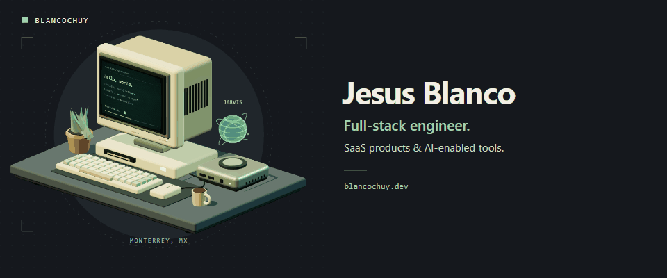
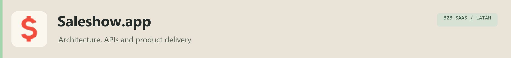
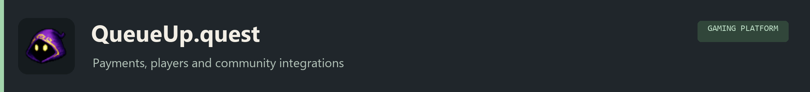
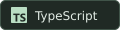
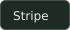
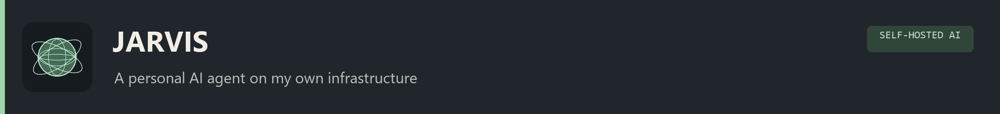
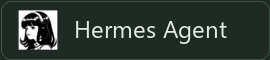
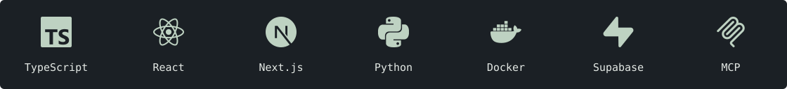

<picture>
  <source media="(prefers-reduced-motion: reduce)" srcset="./assets/profile-still.png">
  
</picture>

### Jesus Blanco · Full-Stack & AI Engineer

I ship production SaaS end to end: Next.js/TypeScript, Laravel, Python, payments, CI/CD and self-hosted infra.

Co-founder and tech lead at Fencode. Built SaleShow.app (99.8% uptime, sub-600 ms APIs) and QueueUp.quest (Stripe/Wise, Discord OAuth).

I build AI agents and agent tooling: MCP servers, [git-why](https://github.com/Blancochuy/git-why) (Go CLI for coding agents) and self-hosted LLM agents.

Monterrey, Mexico (UTC-6) · English C1 · Open to remote US roles: Full-Stack, AI/Agent, Forward Deployed.

  
  
  
  
  

## Selected work

<h3><a href="https://saleshow.app"><picture><source media="(max-width: 800px)" srcset="./assets/projects/saleshow-compact.png"></picture></a></h3>

B2B SaaS for LATAM. Owned architecture, backend APIs, deployment and production support. Running at 99.8% uptime with sub-600 ms API response times.

  
  
  

<h3><a href="https://queueup.quest"><picture><source media="(max-width: 800px)" srcset="./assets/projects/queueup-compact.png"></picture></a></h3>

Full-stack development for a gaming platform, including payments and community integrations.

  
  
  
  
  

<h3><picture><source media="(max-width: 800px)" srcset="./assets/projects/jarvis-compact.png"></picture></h3>

My self-hosted Telegram agent, built on [Hermes](https://github.com/NousResearch/hermes-agent) and extended with modular graph memory, custom tools and Siri voice access.

**Agent runtime**

  
  
  
  

**Custom extensions**

  
  
  
  

**Access and secrets**

  
  

Connected tooling

Infisical manages agent secrets. Remote access uses Cloudflare Tunnels and Zero Trust with authentication codes.

Also supports scheduled jobs, subagents and approval gates.

  
  
  
  

## Open source

<h3><a href="https://github.com/Blancochuy/git-why"> git-why</a></h3>

Git history context for coding agents, exposed through a Go CLI and MCP server.

  
  
  

<h3><a href="https://github.com/Blancochuy/emoji-styles"> emoji-styles</a></h3>

A typed toolkit for custom emoji, interchangeable styles and accessible fallbacks.

  
  
  

## Core toolkit

<picture>
  <source media="(max-width: 800px)" srcset="./assets/technology-stack-compact.svg">
  
</picture>
